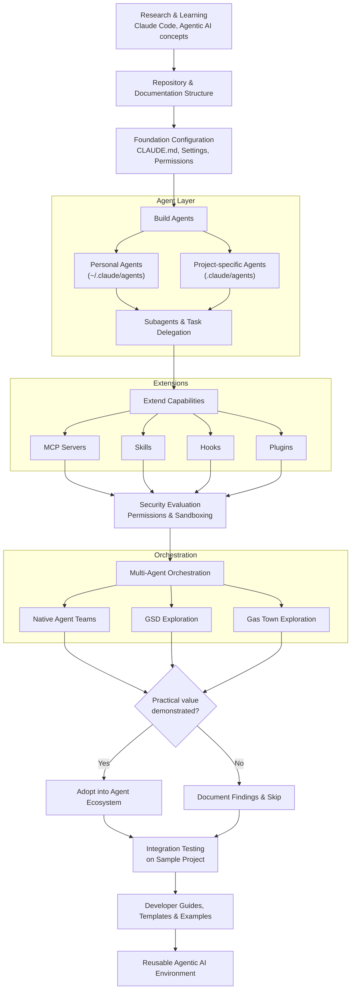
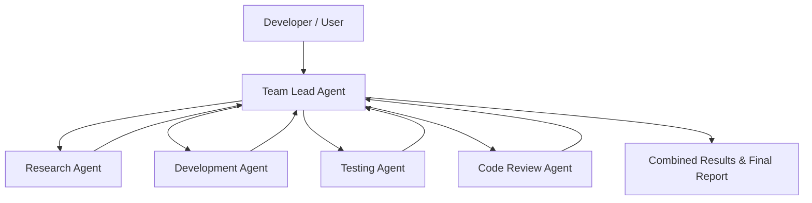
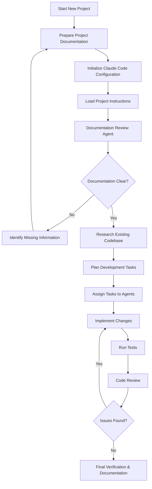

# Claude Code Agentic AI Engineering

A practical Research, Development, and Implementation workspace for building, configuring, managing, and orchestrating AI agents using Claude Code and related agentic AI technologies.

The goal is to develop a reusable AI agent environment that improves software development productivity and provides developers with practical knowledge of Agentic AI Engineering.

---

## 1. Project Overview

This project focuses on building a structured AI agent ecosystem using Claude Code.

Instead of using AI only as a coding assistant, we aim to build specialized agents that can understand software projects, analyze requirements, review documentation, assist with development, perform testing, and collaborate with other agents.

The system will support:

- **Personal Agents:** Reusable agents available across multiple projects.
- **Project-specific Agents:** Agents configured for individual project requirements.
- **Subagents:** Specialized assistants delegated smaller tasks by a primary agent.
- **Agent Teams:** Multiple independent AI agents coordinated to complete larger tasks.
- **External Agent Frameworks:** Explore advanced orchestration tools such as Gas Town and GSD.

This repository will also provide reusable Markdown templates, configuration examples, and beginner-friendly setup guides so other developers can build their own Claude Code agent environments.

### 1.1 Project Workflow Diagram

High-level view of how the project moves from research to a documented, reusable agent environment.



## 2. Main Objectives

1. Build a reusable Personal Agent environment.
2. Configure Project-specific Agents.
3. Develop specialized agents for different software development activities.
4. Enable agents to understand project documentation before starting development tasks.
5. Implement multi-agent collaboration and task delegation.
6. Integrate external tools and services through MCP servers.
7. Explore automation using Hooks, Skills, and Plugins.
8. Understand agent permissions, sandboxing, and security.
9. Explore advanced orchestration frameworks.
10. Provide clear documentation for developers to reproduce the setup.

## 3. Technologies and Techniques

| Technology / Technique | Purpose |
|---|---|
| Claude Code | Primary AI coding environment |
| Claude Models | AI models powering agents |
| Personal Agents | Reusable specialized agents |
| Project-specific Agents | Project-level agent configurations |
| Subagents | Delegated specialized tasks |
| Agent Teams | Coordination between independent agents |
| MCP Servers | Connect external tools and data sources |
| Skills | Reusable knowledge and workflows |
| Hooks | Event-based automation |
| Plugins / Integrations | Extend available capabilities |
| CLAUDE.md | Persistent instructions and project context |
| Settings & Permissions | Configure behavior and access |
| Sandboxing | Isolate and restrict agent execution |
| GSD | Structured, spec-driven AI development workflow |
| Gas Town | Advanced multi-agent orchestration exploration |

**Note:** These technologies have different purposes. They will be studied and implemented separately before being combined into larger workflows. Experimental features and external frameworks will be evaluated before adoption.

## 4. Agent Architecture

The system will use a combination of Personal Agents, Project-specific Agents, and Subagents.

### 4.1 Personal Agents

Stored in the user's Claude Code configuration directory.

Example:

```text
~/.claude/
├── CLAUDE.md
└── agents/
    ├── project-researcher.md
    ├── documentation-reviewer.md
    ├── code-reviewer.md
    ├── debugging-agent.md
    └── testing-agent.md
```

These agents can be reused across different development projects.

### 4.2 Project-specific Agents

Stored inside an individual project's root directory.

```text
project-root/
├── CLAUDE.md
├── docs/
└── .claude/
    └── agents/
        ├── architecture-reviewer.md
        └── project-tester.md
```

These agents will follow project-specific requirements, instructions, and constraints.

### 4.3 Planned Specialized Agents

| Agent | Responsibility |
|---|---|
| Project Researcher | Explore and understand the project structure |
| Documentation Reviewer | Review requirements and technical documents |
| Architecture Reviewer | Analyze architecture and design decisions |
| Code Researcher | Investigate existing code and dependencies |
| Code Developer | Assist with implementation |
| Code Reviewer | Identify bugs and code quality issues |
| Debugging Agent | Investigate errors and root causes |
| Testing Agent | Create and evaluate tests |
| Security Reviewer | Identify security risks |
| Documentation Agent | Maintain technical documentation |

The initial implementation will prioritize project understanding, documentation review, code research, code review, debugging, and testing.

## 5. Project Understanding and Documentation Workflow

A major objective is to ensure agents understand a project before assisting with development.

Each project should maintain structured Markdown documentation, such as:

- Project Overview
- Business Requirements
- Functional Requirements
- System Architecture
- Database Design
- API Documentation
- Business Workflows
- Development Guidelines
- Security Requirements
- Testing Strategy

The Documentation Reviewer will analyze the available documents and report:

- Project purpose and scope.
- Main features and business logic.
- Architecture and technology stack.
- Important workflows and dependencies.
- Missing or unclear requirements.
- Technical risks and inconsistencies.
- Questions that should be clarified before development.

Agents must not assume that missing information is correct or invent undocumented requirements.

## 6. Agent Teams and Multi-Agent Orchestration

Explore how multiple Claude Code instances can work together on larger development tasks.

### Proposed Team Workflow



The Team Lead will:

- Understand the overall task.
- Break down work into smaller tasks.
- Assign tasks to suitable agents.
- Coordinate execution and dependencies.
- Collect and evaluate agent results.
- Report completed work and unresolved issues.

Teammates will perform their assigned tasks independently where possible and communicate through supported team coordination mechanisms.

We will study native Claude Code Agent Teams before exploring external orchestration systems.

## 7. MCP, Skills, Hooks, and Integrations

### MCP Servers
Learn to configure Model Context Protocol servers to connect agents with external tools, services, and data sources.

### Skills
Create reusable workflows and specialized instructions that agents can apply when needed.

### Hooks
Configure event-based automation for activities such as validation, formatting, and testing.

### Plugins and Integrations
Explore supported extensions that improve the capabilities of Claude Code.

These components will be evaluated based on usefulness, security, reliability, and maintenance requirements.

## 8. Security, Permissions, and Sandboxing

Security is a core part of the implementation.

Topics to investigate:

- Claude Code permission settings.
- Read-only and write access.
- Command execution permissions.
- MCP server permissions.
- Credential and environment-variable protection.
- Sandbox configuration.
- Filesystem and network isolation.
- Risks of running agents without sandboxing.
- Sandbox benefits, limitations, and alternatives.

We will compare sandboxed and non-sandboxed execution and document the risks of each approach.

Agents should receive only the permissions required for their assigned responsibilities.

## 9. Advanced Framework Exploration

### GSD – Get Shit Done

Explore GSD as a structured, spec-driven AI development workflow.

Areas of study:

- Project initialization.
- Requirements and specification planning.
- Task breakdown.
- Context engineering.
- Execution workflows.
- Verification and validation.

### Gas Town

Explore Gas Town as an advanced multi-agent workspace and orchestration system.

Areas of study:

- Team coordination.
- Agent roles and responsibilities.
- Parallel task execution.
- Work tracking.
- Agent communication.
- Managing multiple coding-agent instances.

Both frameworks will first be evaluated independently. They will only be adopted if they provide practical value to our agent ecosystem.

## 10. Development Workflow

The proposed workflow for using this system on a new software project:



The workflow may be adapted depending on project complexity, available agents, and task dependencies.

## 11. Implementation Roadmap

| Phase | Focus | Status |
|---|---|---|
| 01 | Repository and documentation structure | Planned |
| 02 | Personal Claude Code configuration | Planned |
| 03 | First Personal Agents | Planned |
| 04 | Project-specific Agents | Planned |
| 05 | Project documentation templates | Planned |
| 06 | Subagents and task delegation | Planned |
| 07 | MCP server integrations | PASS WITH LIMITATIONS: Atlassian MCP connects and its 26 tools are discovered, but Trello access is unverified (Rovo Search returned HTTP 502). See [docs/MCP_SETUP_GUIDE.md](docs/MCP_SETUP_GUIDE.md) |
| 08 | Skills, Hooks, Plugins and Settings | Planned |
| 09 | Permissions and Sandbox evaluation | Planned |
| 10 | Native Agent Teams | Planned |
| 11 | GSD workflow exploration | Planned |
| 12 | Gas Town exploration | Planned |
| 13 | Integration and sample project testing | Planned |
| 14 | Developer setup guides and examples | Planned |

Statuses will be updated as each phase is implemented and verified.

## 12. Repository Documentation Structure

The repository will maintain a clean and organized documentation structure.

```text
claude-code-agentic-ai/
│
├── README.md
│
├── docs/
│   ├── installation-guide.md
│   ├── personal-agents-guide.md
│   ├── project-agents-guide.md
│   ├── subagents-guide.md
│   ├── agent-teams-guide.md
│   ├── mcp-setup-guide.md
│   ├── hooks-and-skills-guide.md
│   ├── settings-and-permissions.md
│   ├── sandbox-security-guide.md
│   ├── gsd-guide.md
│   ├── gastown-guide.md
│   └── troubleshooting.md
│
├── agents/
│   ├── personal/
│   └── project-templates/
│
├── templates/
│   ├── CLAUDE.md
│   └── project-documentation/
│
├── examples/
│   └── sample-project/
│
└── configurations/
```

Individual guides will be created as their corresponding topics are implemented.

## 13. Documentation Principles

All documentation and configuration examples should follow these principles:

- Use simple, professional English.
- Keep Markdown files clean and easy to understand.
- Provide practical examples where useful.
- Explain setup steps in the correct order.
- Include diagrams for complex workflows.
- Clearly distinguish planned features from implemented features.
- Document security considerations and limitations.
- Avoid unnecessary duplication between documents.
- Keep instructions updated when configurations change.

## 14. Expected Outcome

The final outcome will be a reusable and well-documented Claude Code Agentic AI environment that:

- Supports Personal and Project-specific Agents.
- Understands software projects through structured documentation.
- Supports specialized agents and subagents.
- Enables multi-agent collaboration.
- Integrates external tools through MCP.
- Uses automation and security controls appropriately.
- Provides reusable configurations and templates.
- Helps other developers establish their own agent environments.

**Project Goal:** Develop practical Agentic AI Engineering skills and build a reliable, reusable AI-powered development workflow.
