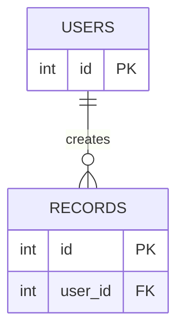

# Database Schema Documentation

## 1. Database Overview

| Field | Details |
|---|---|
| Database Name | |
| Database System | |
| Database Version | |
| ORM / Query Builder | |
| Migration Tool | |
| Database Hosting | |

### Database Purpose

Describe what information the database stores and how it supports the application.

## 2. Database Architecture

Describe the overall database design.

- Database architecture:
- Schema organization:
- Data access approach:
- Transaction management:

## 3. Database Tables

Document every important database table.

| Table Name | Purpose | Primary Key |
|---|---|---|
| | | |
| | | |

### Table Structure

Use this format for each table.

#### Table: `[TABLE_NAME]`

**Purpose:**

Describe the responsibility of this table.

| Column | Data Type | Nullable | Default | Description |
|---|---|---|---|---|
| id | | No | | |
| | | | | |

**Primary Key:**
- 

**Foreign Keys:**
- 

**Unique Constraints:**
- 

**Indexes:**
- 

**Additional Notes:**
- 

## 4. Table Relationships

Document how database tables are connected.

| Parent Table | Child Table | Relationship | Foreign Key |
|---|---|---|---|
| | | One-to-One / One-to-Many / Many-to-Many | |
| | | | |

### Relationship Rules

Explain important relationship rules and deletion/update behavior.

- 
- 
- 

## 5. Entity Relationship Diagram (ERD)

Add an ER diagram if available.

The example above is illustrative only. Replace it with the actual database relationships.

## 6. Indexes and Constraints

Document important database indexes and constraints.

| Name | Table | Type | Purpose |
|---|---|---|---|
| | | Index / Unique / Check / Foreign Key | |
| | | | |

Explain why important indexes exist and which queries they support.

## 7. Data Integrity Rules

Document rules that protect the correctness of stored data.

Examples:
- Required fields must not be NULL.
- Unique identifiers must not be duplicated.
- Foreign keys must reference valid records.
- Important state transitions must follow business rules.
- Related updates must use transactions where necessary.

**Project-specific rules:**

- 
- 
- 

## 8. Database Migrations

Describe how database structure changes are managed.

| Migration | Description | Status |
|---|---|---|
| | | Applied / Pending |
| | | Applied / Pending |

Document:
- Migration naming conventions
- Migration execution process
- Rollback procedures
- Production migration precautions

## 9. Data Lifecycle

Describe how records are created, updated, archived, and deleted.

- Record creation:
- Record updates:
- Soft deletion:
- Hard deletion:
- Data retention:
- Backup and recovery:

## 10. Database Security

Document:
- Database access permissions
- Sensitive data protection
- Encryption requirements
- Connection security
- Backup security
- Credential management

Never include actual passwords, connection strings, API keys, or secrets.

## 11. Performance Considerations

Document:
- Frequently executed queries
- Important indexes
- Query optimization techniques
- Connection pooling
- Transaction considerations
- Potential bottlenecks

## 12. Known Database Issues

| Issue | Description | Impact | Status |
|---|---|---|---|
| | | | Open / Resolved |
| | | | Open / Resolved |

## 13. AI Agent Database Review Instructions

Before making database-related changes, AI agents must:

1. Read this document completely.
2. Inspect the actual schema and migration files.
3. Verify table names, columns, types, and relationships.
4. Check foreign keys, unique constraints, and indexes.
5. Understand existing data integrity rules.
6. Identify possible impacts on existing records.
7. Review transaction and concurrency requirements.
8. Never execute destructive database operations without explicit approval.
9. Never modify production data or schemas without authorization.
10. Update this document when approved database changes are implemented.

**Important:** The actual database schema, ORM models, and migration files are the source of truth. This document must be verified against them and must not be treated as a substitute for inspecting the implementation.

---

*Document Status: Template*  
*Last Updated: [Date]*