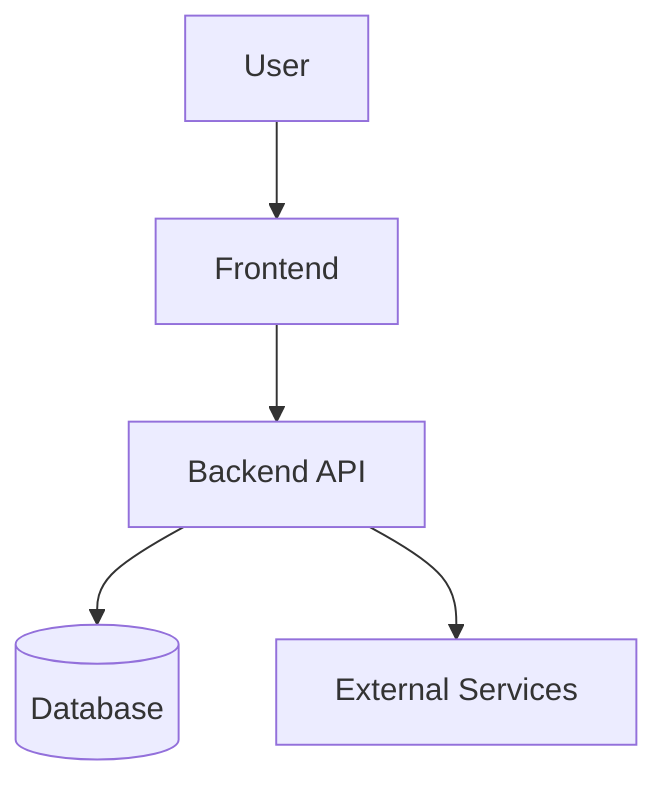

# Technical Architecture

## 1. Architecture Overview

Describe the overall technical architecture of the application.

### Architecture Style

Examples:
- Monolithic
- Microservices
- Modular Monolith
- Serverless
- Client-Server

**Selected Architecture:**

**Architecture Description:**

## 2. System Architecture Diagram

Add a diagram showing how the main components communicate.



## 3. Frontend Architecture

### Technology

| Item | Details |
|---|---|
| Framework | |
| Programming Language | |
| UI Library | |
| State Management | |
| Routing | |
| Build Tool | |

### Frontend Structure

Describe the main frontend folders and their responsibilities.

| Folder / Component | Responsibility |
|---|---|
| | |
| | |

### Frontend Responsibilities

- 
- 
- 

## 4. Backend Architecture

### Technology

| Item | Details |
|---|---|
| Runtime | |
| Framework | |
| Programming Language | |
| API Style | REST / GraphQL / Other |
| Validation | |
| Background Jobs | |

### Backend Structure

Describe the backend folders and their responsibilities.

| Folder / Module | Responsibility |
|---|---|
| | |
| | |

### Backend Responsibilities

- 
- 
- 

## 5. Database Architecture

### Database Information

| Item | Details |
|---|---|
| Database System | |
| ORM / Query Builder | |
| Database Hosting | |
| Migration Tool | |

### Main Database Entities

| Entity / Table | Purpose | Relationships |
|---|---|---|
| | | |
| | | |

### Database Design

Describe:
- Main relationships
- Primary and foreign keys
- Important constraints
- Indexing strategy
- Transaction handling

Add an ER diagram if available.

## 6. API Architecture

Describe how the frontend and external clients communicate with the backend.

| API / Endpoint Group | Purpose | Authentication |
|---|---|---|
| | | |
| | | |

### API Standards

- HTTP methods and status codes:
- Request validation:
- Response format:
- Error handling:
- API versioning:

## 7. Authentication and Authorization

Explain how users authenticate and how permissions are enforced.

### Authentication Flow

1. 
2. 
3. 
4. 

### Authorization

| Role | Permissions |
|---|---|
| | |
| | |

Document important middleware, guards, and access-control mechanisms.

## 8. Data Flow Architecture

Describe how information moves through the system.

Example:

```text
User Action
    |
    v
Frontend
    |
    v
API Request
    |
    v
Backend Validation
    |
    v
Business Logic
    |
    v
Database Operation
    |
    v
API Response
    |
    v
Frontend Update
```

## 9. External Integrations

| Service | Integration Method | Purpose | Failure Handling |
|---|---|---|---|
| | | | |
| | | | |

Document API dependencies, webhooks, queues, and synchronization mechanisms.

## 10. Background Jobs and Events

Describe asynchronous processes.

| Job / Event | Trigger | Responsibility | Retry Strategy |
|---|---|---|---|
| | | | |
| | | | |

## 11. Deployment Architecture

### Environments

| Environment | Purpose | Hosting |
|---|---|---|
| Development | Local development | |
| Staging | Testing and validation | |
| Production | Live application | |

### Deployment Process

Describe:
1. Build process
2. Deployment process
3. Environment configuration
4. Database migrations
5. Rollback strategy

## 12. Testing Architecture

| Test Type | Framework / Tool | Purpose |
|---|---|---|
| Unit Testing | | |
| Integration Testing | | |
| API Testing | | |
| End-to-End Testing | | |
| Performance Testing | | |

## 13. Logging and Monitoring

Document:
- Application logging
- Error monitoring
- Performance monitoring
- Database monitoring
- Alerting mechanisms

## 14. Security Architecture

Document:
- Secrets management
- Input validation
- Data protection
- API security
- Access control
- Rate limiting
- Secure communication

Never include actual credentials, API keys, passwords, or access tokens.

## 15. Technical Dependencies

| Dependency | Version | Purpose | Criticality |
|---|---|---|---|
| | | | High / Medium / Low |
| | | | High / Medium / Low |

## 16. Technical Constraints and Decisions

Document important architectural decisions and their reasons.

| Decision | Reason | Impact |
|---|---|---|
| | | |
| | | |

## 17. AI Agent Architecture Review Instructions

Before proposing or implementing architectural changes, AI agents must:

1. Read this document completely.
2. Inspect the actual source-code structure.
3. Verify whether documented technologies and architecture match the implementation.
4. Trace important API and data flows.
5. Review database relationships and constraints.
6. Identify dependencies between modules.
7. Check security and authorization boundaries.
8. Avoid introducing unnecessary architectural complexity.
9. Explain the impact of proposed changes.
10. Update this document when approved architectural changes are implemented.

**Important:** This document describes the intended technical architecture. Agents must verify all details against the actual codebase. Do not assume that an empty or undocumented section means a feature does not exist.

---

*Document Status: Template*  
*Last Updated: [Date]*